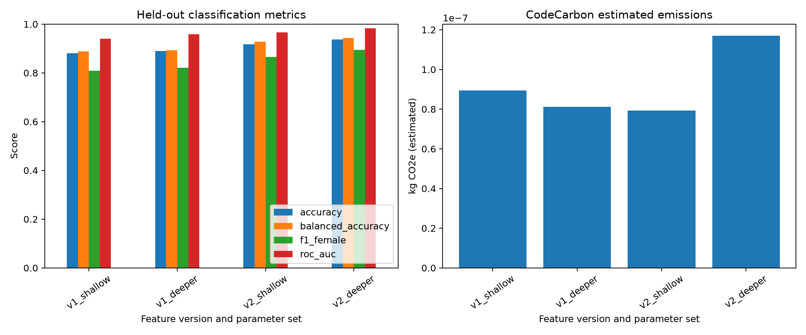
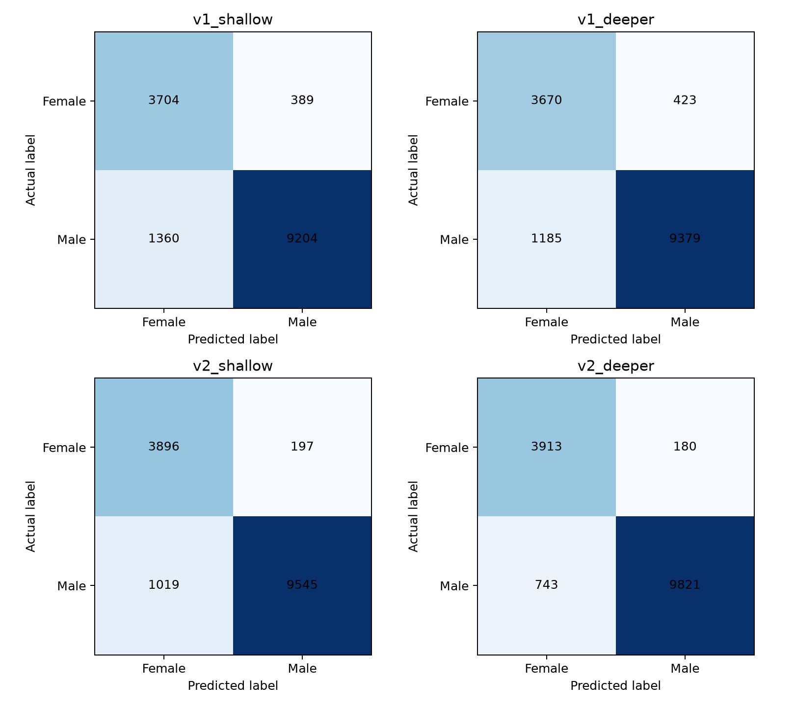

# ADSP 32021 Assignment 2

This project compares two versions of athlete features for predicting the gender label recorded in the supplied `athletes.csv`. The reported scores describe that CSV field.

## Data

The source CSV is [Crossfit Athletes](https://www.kaggle.com/datasets/ulrikthygepedersen/crossfit-athletes) by Ulrik Thyge Pedersen, licensed under [CC BY 4.0](https://creativecommons.org/licenses/by/4.0/). The included CSV is unchanged. The pipeline creates the cleaned cohort and feature versions described below.

The source has 423,006 rows. The pipeline removes two exact duplicate rows and keeps records with a unique athlete ID, a recorded `Male` or `Female` label, and valid values for every selected feature. This produces one shared cohort of 73,281 athletes: 20,466 Female and 52,815 Male. The split is stratified, 80% training and 20% test, with random seed 42. The same train and test IDs are used for all four runs.

The broad validity ranges remove missing values and obvious invalid values, including the `8,388,607` sentinel found in the source. Values are treated in the source's recorded units.

| Feature | Accepted range |
|---|---:|
| Age | 13-100 |
| Height | 48-84 |
| Weight | 75-500 |
| Clean and jerk | 0-1,000 |
| Snatch | 0-800 |
| Deadlift | 0-1,200 |
| Back squat | 0-1,000 |

## Pipeline

- Feast registers two feature views and their matching FeatureServices in a local feature repository. The pipeline reads both versions through Feast's historical feature retrieval and checks the returned values against the source rows.
- The CSV has no event-time field. Each row receives the same fixed snapshot timestamp only to satisfy Feast's historical retrieval interface. This timestamp is not used as a feature or treated as an event date.
- MLflow Projects runs the four experiment combinations locally. No AutoML is used.
- The same `DecisionTreeClassifier` is used each time, with class weights balanced to account for the unequal class counts.
- CodeCarbon's offline tracker records estimated energy and emissions during each fit and prediction.

| Feature version | Model features |
|---|---|
| v1 | Age, height, weight |
| v2 | v1 plus clean and jerk, snatch, deadlift, back squat |

| Parameter set | `max_depth` | `min_samples_leaf` |
|---|---:|---:|
| shallow | 3 | 20 |
| deeper | 8 | 100 |

## Results

Female is the positive class for precision, recall, and F1. These are held-out results from the shared test split.

| Run | Accuracy | Balanced accuracy | Female F1 | ROC AUC |
|---|---:|---:|---:|---:|
| v1 shallow | 0.8807 | 0.8881 | 0.8090 | 0.9408 |
| v1 deeper | 0.8903 | 0.8922 | 0.8203 | 0.9580 |
| v2 shallow | 0.9170 | 0.9277 | 0.8650 | 0.9657 |
| v2 deeper | 0.9370 | 0.9428 | 0.8945 | 0.9829 |

Version 2 with the deeper parameter set has the highest values in this comparison. Its confusion matrix and the other three appear in the notebook and result plots.





## CodeCarbon

CodeCarbon 3.3.2 ran in offline mode with the United States national grid mix (`country_iso_code=USA`, no region override), process tracking, and a one-second measurement interval. The four recorded durations were under 0.2 seconds. On this macOS machine, CodeCarbon reported that it could not find a CPU tracking mode and fell back to CPU-load estimation; the CSV records zero CPU utilization for these short runs. The figures are estimates, not power-meter readings, and their small differences should not be read as a meaningful efficiency ranking.

| Run | CodeCarbon duration (s) | Estimated energy (kWh) | Estimated emissions (kg CO2e) |
|---|---:|---:|---:|
| v1 shallow | 0.173261917 | 2.42146166912e-07 | 8.94664707274e-08 |
| v1 deeper | 0.142292542 | 2.19725135748e-07 | 8.11825050801e-08 |
| v2 shallow | 0.138271458 | 2.14708688008e-07 | 7.93290630844e-08 |
| v2 deeper | 0.188195583 | 3.16664287827e-07 | 1.16998904416e-07 |

## Reproduce

```sh
uv sync --locked --python 3.12
uv run python src/run_pipeline.py --data data/athletes.csv --config config.json
```

Each run creates a dated folder under `outputs/runs/` with the shared split, both Feast read results, MLflow run IDs and metrics, CodeCarbon CSVs, models, confusion matrices, and comparison plots. The local MLflow database is `mlflow.db`.

The executed report notebook is [notebooks/ADSP32021_Assignment2.ipynb](notebooks/ADSP32021_Assignment2.ipynb). To execute it again:

```sh
uv sync --locked --python 3.12 --group notebook
uv run --group notebook jupyter nbconvert --to notebook --execute --inplace notebooks/ADSP32021_Assignment2.ipynb
```

## Package versions and documentation

- Python 3.12, MLflow 3.17.2, Feast 0.67.0, CodeCarbon 3.3.2, scikit-learn 1.9.1.
- [MLflow Projects](https://mlflow.org/docs/latest/ml/projects/)
- [Feast local quickstart](https://docs.feast.dev/getting-started/quickstart)
- [Feast feature-service versioning guidance](https://docs.feast.dev/getting-started/faq)
- [CodeCarbon installation](https://docs.codecarbon.io/latest/how-to/installation/)
- [CodeCarbon API](https://docs.codecarbon.io/latest/reference/api/)
